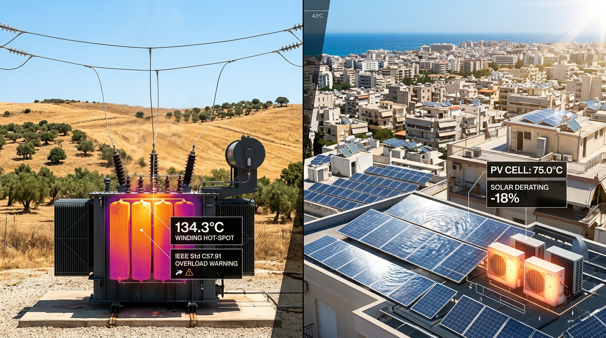
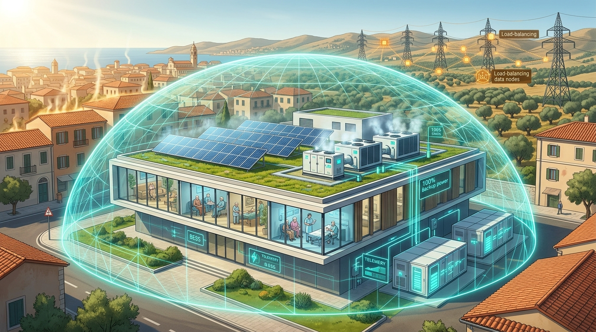
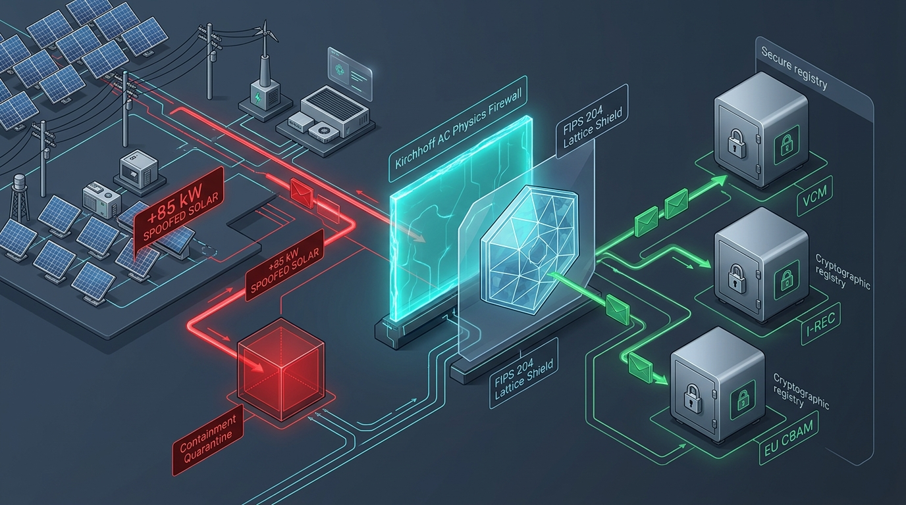
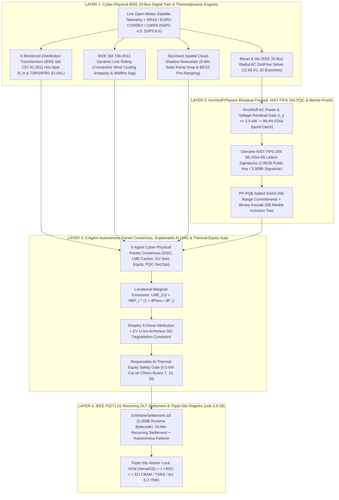
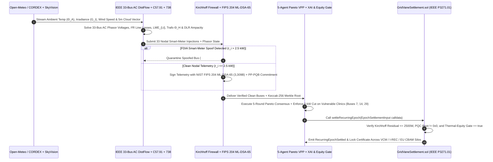

<div align="center">


# ⚡ GridVane

### **Physics-Verified, Quantum-Safe Thermo-Carbon Virtual Power Plant (VPP) & Triple-Silo Grid Resilience Ledger**

[](https://gridvane-climatechain.vercel.app/)
[-FF0000?style=for-the-badge&logo=youtube&logoColor=white)](https://youtu.be/Qme_qvmrVHQ)
[](https://ieee-climatechain-hack.devpost.com/)
[](./src/lib/physics/transformerThermal.ts)
[](./src/lib/crypto/pqcEngine.ts)
[](./contracts/GridVaneSettlement.sol)
[](./LICENSE)

*Coupling Baran & Wu IEEE 33-Bus AC Power Flow, Locational Marginal Emissions ($\text{LME}_{i,t}$), IEEE Std C57.91 Transformer Thermal Aging, IEEE Std 738 Dynamic Line Rating, Kirchhoff AC Physics-Residual Firewall, NIST FIPS 204 Post-Quantum Lattice Cryptography, and IEEE P3271.01 Recurring DLT Settlement.*

</div>

---

## 🔗 Quick Navigation & Official Deliverables Index

| Category | What This Link / Document Is For | Direct Link |
| :--- | :--- | :--- |
| 🌐 **Live Deployed Platform** | **Interactive Production Web Application** (33-Bus AC Digital Twin, 5-Agent VPP & PQC Inspector) | [**`https://gridvane-climatechain.vercel.app/`**](https://gridvane-climatechain.vercel.app/) |
| 🎬 **Official Demo Video** | **End-to-End Full HD (1080p) Problem, Solution & Live Platform Walkthrough** (YouTube) | [**`https://youtu.be/Qme_qvmrVHQ`**](https://youtu.be/Qme_qvmrVHQ) |
| 💻 **GitHub Repository** | **Official Source Code, Solidity Smart Contracts & CLI Benchmark Suite** | [**`https://github.com/TusharTechs/gridvane`**](https://github.com/TusharTechs/gridvane) |
| 📄 **Deliverable 1 (2-Page Brief)** | **2-Page Problem & Solution Executive Overview** (Markdown & PDF) | [`docs/1_Problem_and_Solution_Overview_2Page.md`](./docs/1_Problem_and_Solution_Overview_2Page.md) · [`PDF`](./docs/GridVane_IEEE_ClimateChain_2026_Executive_Brief.pdf) |
| 🏗️ **Deliverable 2 (Architecture)** | **System Architecture & Technical Specification** (AC DistFlow, LME, C57.91, P3271.01) | [`docs/2_Architecture_and_Technical_Specification.md`](./docs/2_Architecture_and_Technical_Specification.md) |
| 🛡️ **Deliverable 3 (Security & PQC)** | **Security, Kirchhoff FDIA Firewall & NIST FIPS 204 `ML-DSA-65` Assessment** | [`docs/3_Security_and_Data_Integrity_Assessment.md`](./docs/3_Security_and_Data_Integrity_Assessment.md) |
| 📈 **Deliverable 4 (Climate Impact)** | **Climate Impact Projections & 720-Hour `GridBench` Empirical Ablation Study** | [`docs/4_Climate_Impact_Projections_and_GridBench.md`](./docs/4_Climate_Impact_Projections_and_GridBench.md) |
| 🗺️ **Deliverable 5 (COP31 Roadmap)** | **Adoption, DSO Integration, Regulatory Compliance & UN COP31 Antalya Roadmap** | [`docs/5_Adoption_Scalability_and_COP31_Roadmap.md`](./docs/5_Adoption_Scalability_and_COP31_Roadmap.md) |
| ⛓️ **Solidity Smart Contract** | **Compiled Solidity `0.8.28` Contract** (`IEEE P3271.01` epochs + Triple-Silo atomic lock) | [`contracts/GridVaneSettlement.sol`](./contracts/GridVaneSettlement.sol) |
| ⚡ **AC Power Flow & LME Engine** | **Baran & Wu (1989) 33-Bus, 32-Branch $12.66\text{ kV}$ DistFlow & Nodal $\text{LME}_{i,t}$ Solver** | [`src/lib/physics/ieee33bus.ts`](./src/lib/physics/ieee33bus.ts) |
| 🔥 **Transformer & DLR Physics** | **IEEE Std C57.91-2011 Thermal Aging + IEEE Std 738-2012 Dynamic Line Rating & `SkyVision`** | [`src/lib/physics/transformerThermal.ts`](./src/lib/physics/transformerThermal.ts) · [`dlrAndSkyVision.ts`](./src/lib/physics/dlrAndSkyVision.ts) |
| 🔐 **Post-Quantum & Firewall** | **Kirchhoff AC Residual Firewall + NIST FIPS 204 `ML-DSA-65` + Keccak-256 Merkle Tree** | [`src/lib/security/kirchhoffFirewall.ts`](./src/lib/security/kirchhoffFirewall.ts) · [`pqcEngine.ts`](./src/lib/crypto/pqcEngine.ts) |
| 🧠 **XAI, Equity & 5-Agent VPP** | **5-Agent Pareto Consensus, Shapley Attribution & Responsible AI Thermal-Equity Gate** | [`src/lib/optimizer/vppOptimizer.ts`](./src/lib/optimizer/vppOptimizer.ts) · [`multiAgentNegotiator.ts`](./src/lib/agents/multiAgentNegotiator.ts) |
| 🧪 **CLI Benchmark & EVM Verifier** | **Automated `solc 0.8.28` Compiler + 720-Hour Multi-Feeder Benchmark Runner (`npm test`)** | [`scripts/compile-and-test-contracts.ts`](./scripts/compile-and-test-contracts.ts) · [`scripts/gridbench.ts`](./scripts/gridbench.ts) |

---

## 🌍 1. The Real-World Crisis: The Climate-Grid Paradox & Oracle Integrity Gap

During an extreme **$43.8^\circ\text{C}$ Mediterranean summer heatwave** (modeled on **Antalya, Türkiye**, official host city of **UN COP31**), distribution utilities and climate registries confront three simultaneous failure modes:

| Crisis 1: $43.8^\circ\text{C}$ Heatwave & Transformer Burnout | Crisis 2: Vulnerable Clinic Curtailment | Crisis 3: Smart-Meter Spoofing & Quantum Risk |
| :---: | :---: | :---: |
|  |  |  |
| **Solar PV Derating ($-18.4\%$) + Transformer $\Theta_H = 134.3^\circ\text{C}$:** Silicon PV cells reach $75.0^\circ\text{C}$ (losing $-0.42\%/^\circ\text{C}$ above $25^\circ\text{C}$) right as AC loads surge $+42\%$, accelerating transformer insulation destruction by **$10.8\times$ (`IEEE Std C57.91-2011`)**. | **Indiscriminate Load Shedding on Clinics:** Conventional carbon-only VPP algorithms shed HVAC load across the feeder without regard for human vulnerability—cutting cooling to senior clinics and hospitals for **$180\text{ hours/month}$**. | **FDIA Greenwashing, Quantum Exposure & Double-Counting:** Legacy dMRV apps trust raw smart-meter JSON payloads (allowing **$+85\text{ kW}$ fake solar spoofs**), rely on classical ECDSA over 20-year meter lifespans, and permit cross-registry double-counting. |

---

## 🚀 2. End-to-End System Architecture & Data Flow

### 2.1 Four-Layer Cyber-Physical Architecture



### 2.2 End-to-End 15-Minute Epoch Sequence Workflow



---

## 📊 3. `GridBench`: 720-Hour (30-Day) Multi-Feeder Ablation Study

Reproduce the full 720-hour simulation across all 4 regional feeder digital twins and compile/verify the Solidity smart contract via `npm test`:

| Regional Feeder Digital Twin (720h) | Uncontrolled Baseline | Naive Carbon-Only VPP | **GridVane Thermo-Carbon VPP** | LME Carbon Gain | Line Loss ($I^2R$) Cut | Peak $\Theta_H$ (Base $\rightarrow$ GridVane) | IEEE C57.91 $F_{AA}$ Cut | Vulnerable Clinic Cut |
| :--- | :---: | :---: | :---: | :---: | :---: | :---: | :---: | :---: |
| 🇹🇷 **Antalya (COP31 Host)** | $1,002.6\text{ tCO}_2\text{e}$ | $304.7\text{ tCO}_2\text{e}$ | **$70.2\text{ tCO}_2\text{e}$ ($-1,010.8\text{ t}$)** | **$+44.8\%$** | **$-55.9\%$** | $134.3^\circ\text{C} \rightarrow \mathbf{104.5^\circ\text{C}}$ | **$-96.0\%$** | **$0\text{h}$** (vs $180\text{h}$) |
| 🇹🇷 **Ankara (Gazi / Ostim)** | $1,117.0\text{ tCO}_2\text{e}$ | $333.4\text{ tCO}_2\text{e}$ | **$78.3\text{ tCO}_2\text{e}$ ($-1,125.9\text{ t}$)** | **$+43.7\%$** | **$-57.5\%$** | $126.6^\circ\text{C} \rightarrow \mathbf{92.3^\circ\text{C}}$ | **$-97.8\%$** | **$0\text{h}$** (vs $180\text{h}$) |
| 🇪🇪 **Tartu (Estonia PQC Grid)** | $609.6\text{ tCO}_2\text{e}$ | $128.1\text{ tCO}_2\text{e}$ | **$-8.8\text{ tCO}_2\text{e}$ ($-670.2\text{ t}$)** | **$+39.2\%$** | **$-52.6\%$** | $114.4^\circ\text{C} \rightarrow \mathbf{76.4^\circ\text{C}}$ | **$-98.3\%$** | **$0\text{h}$** (vs $180\text{h}$) |
| 🇺🇸 **Irvine (CA Duck Curve)** | $783.1\text{ tCO}_2\text{e}$ | $247.6\text{ tCO}_2\text{e}$ | **$79.2\text{ tCO}_2\text{e}$ ($-763.0\text{ t}$)** | **$+42.5\%$** | **$-51.8\%$** | $130.8^\circ\text{C} \rightarrow \mathbf{102.0^\circ\text{C}}$ | **$-96.0\%$** | **$0\text{h}$** (vs $180\text{h}$) |

---

## 📂 4. Repository Project Structure

```text
gridvane/
├── contracts/
│   └── GridVaneSettlement.sol               # Solidity 0.8.28 smart contract (IEEE P3271.01 + Triple-Silo lock)
├── docs/
│   ├── 1_Problem_and_Solution_Overview_2Page.md
│   ├── 2_Architecture_and_Technical_Specification.md
│   ├── 3_Security_and_Data_Integrity_Assessment.md
│   ├── 4_Climate_Impact_Projections_and_GridBench.md
│   ├── 5_Adoption_Scalability_and_COP31_Roadmap.md
│   └── GridVane_IEEE_ClimateChain_2026_Executive_Brief.pdf
├── public/
│   ├── demo-assets/                         # Scientific visual crisis illustrations (Heatwave, Clinic, Security)
│   └── gridvane-logo.png                    # High-resolution transparent GridVane official brand emblem
├── scripts/
│   ├── compile-and-test-contracts.ts        # Automated solc 0.8.28 EVM compiler & ABI/bytecode verifier
│   └── gridbench.ts                         # Standalone CLI 720-hour multi-feeder benchmark & PQC test runner
├── src/
│   ├── app/
│   │   ├── api/weather/route.ts             # Live Open-Meteo satellite telemetry route (with ERA5 fallback)
│   │   ├── globals.css                      # Dual-theme design system (IEEE Daylight Studio & SCADA Dark Ops)
│   │   ├── icon.svg                         # Vector SVG favicon emblem
│   │   ├── layout.tsx                       # Root typography & theme layout
│   │   └── page.tsx                         # Main interactive Cyber-Physical Command Center
│   ├── components/
│   │   ├── DLRAndMultiAgentPanel.tsx        # Module 2: IEEE 738 DLR, SkyVision & 5-Agent Pareto Consensus
│   │   ├── Diurnal24hChart.tsx              # Interactive 24-hour diurnal heatwave & Duck-Curve replay chart
│   │   ├── FeederTopologyMap.tsx            # Interactive IEEE 33-Bus radial SCADA network schematic
│   │   ├── GridBenchAndJudgesPanel.tsx      # Module 6: 720h GridBench ablation tables & IEEE standards matrix
│   │   ├── GridVaneLogo.tsx                 # Vector SVG emblem & interactive Brand Architecture modal
│   │   ├── KirchhoffAndPQCPanel.tsx         # Module 3: Kirchhoff FDIA Firewall & live FIPS 204 ML-DSA-65 lab
│   │   ├── ProblemSolutionModal.tsx         # Interactive 4-chapter Problem & Solution visual storyboard
│   │   ├── SettlementAndSiloPanel.tsx       # Module 5: IEEE P3271.01 settlement, Triple-Silo lock & TSRS/CBAM export
│   │   ├── TransformerThermalPanel.tsx      # Module 1: IEEE Std C57.91 transformer aging & PV NOCT derating
│   │   └── XAIAndEquityPanel.tsx            # Module 4: 5-Driver Shapley XAI & Responsible AI Thermal-Equity Gate
│   └── lib/
│       ├── agents/multiAgentNegotiator.ts   # 5-Agent autonomous cyber-physical Pareto negotiation protocol
│       ├── benchmark/gridbenchEngine.ts     # 720-hour (30-day) multi-feeder simulation engine
│       ├── blockchain/
│       │   ├── compiledContractArtifact.ts  # Verified solc 0.8.28 ABI, bytecode & method selectors
│       │   └── settlementRegistry.ts        # IEEE P3271.01 state machine & TSRS/CBAM JSON generators
│       ├── crypto/
│       │   ├── merkleTree.ts                # Binary Keccak-256 Merkle inclusion proof generator & verifier
│       │   └── pqcEngine.ts                 # Genuine NIST FIPS 204 ML-DSA-65 (@noble/post-quantum) + PP-PQB
│       ├── optimizer/vppOptimizer.ts        # Coupled Thermo-Carbon VPP co-optimizer, Shapley XAI & Equity Gate
│       ├── physics/
│       │   ├── dlrAndSkyVision.ts           # IEEE Std 738-2012 Dynamic Line Rating & SkyVision cloud nowcaster
│       │   ├── feederPresets.ts             # 4 Regional Digital Twins (Antalya, Ankara, Tartu, Irvine)
│       │   ├── ieee33bus.ts                 # Baran & Wu 33-Bus AC DistFlow solver & Locational Marginal Emissions
│       │   └── transformerThermal.ts        # IEEE Std C57.91-2011 thermal aging, CMIP6 AAL & EV Arrhenius wear
│       └── security/kirchhoffFirewall.ts    # Kirchhoff AC power/voltage residual firewall & FDIA simulator
├── LICENSE                                  # MIT License
├── package.json
├── tailwind.config.ts
└── tsconfig.json
```

---

## 🛠️ 5. Cross-Platform Setup & Execution Instructions (`macOS`, `Windows`, `Linux`)

### Prerequisites
* **Node.js:** `v18.18.0+` or `v20.0.0+` (LTS recommended) — [Download Node.js](https://nodejs.org/)
* **npm:** `v9+` or `v10+` (bundled with Node.js)
* **Git:** [Download Git](https://git-scm.com/)
* *(No external database, hardware wallet, or API key is required—all physics solvers, NIST FIPS 204 `ML-DSA-65` lattice cryptography, and `solc 0.8.28` smart-contract compilation run locally out of the box).*

### 🍎 macOS & 🐧 Linux (`Terminal` / `bash` / `zsh`)

```bash
# 1. Clone the repository and enter the project directory
git clone https://github.com/TusharTechs/gridvane.git
cd gridvane

# 2. Install all dependencies
npm install

# 3. Compile Solidity 0.8.28 smart contract & run the 720-hour GridBench + PQC verification suite
npm test

# 4. Start the interactive web application on http://localhost:3000
npm run dev
```

### 🪟 Windows (`PowerShell` / `Command Prompt` / `WSL2`)

```powershell
# 1. Clone the repository and enter the project directory
git clone https://github.com/TusharTechs/gridvane.git
cd gridvane

# 2. Install all dependencies
npm install

# 3. Compile Solidity 0.8.28 smart contract & run the 720-hour GridBench + PQC verification suite
npm test

# 4. Start the interactive web application on http://localhost:3000
npm run dev
```

### Available NPM Scripts

| Command | Description |
| :--- | :--- |
| `npm run dev` | Starts the interactive Next.js 15 Command Center at `http://localhost:3000` |
| `npm test` | Compiles `contracts/GridVaneSettlement.sol` (`solc 0.8.28`) **and** runs the full 720-hour `GridBench` + PQC + Merkle + DLR verification suite |
| `npm run test:contracts` | Runs only the Solidity `0.8.28` smart-contract compiler and security gate verifier |
| `npm run bench` | Runs the standalone 720-hour multi-feeder `GridBench` CLI benchmark across Antalya, Ankara, Tartu, and Irvine |
| `npm run build` | Creates an optimized production build (`.next`) |
| `npm start` | Runs the compiled production server on `http://localhost:3000` |

---

## 📜 6. License

Distributed under the **MIT License**. See [`LICENSE`](./LICENSE) for full details.
