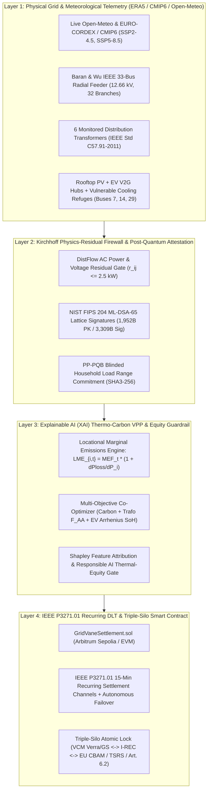

# GridVane: System Architecture & Technical Specification
**IEEE ClimateChain Global Hackathon 2026 — Engineering Deliverable #2**

---

## 1. End-to-End Cyber-Physical Architecture

---

## 2. Mathematical Formulation of Core Engines

### 2.1 Iterative Forward-Backward Sweep (DistFlow) AC Power Flow (`src/lib/physics/ieee33bus.ts`)
On the standard Baran & Wu (1989) IEEE 33-Bus radial distribution system ($V_{\text{base}} = 12.66\text{ kV}$, $S_{\text{base}} = 10\text{ MVA}$), active and reactive power flows on branch $e = (u \rightarrow v)$ are solved iteratively:
$$P_{uv} = P_v^{\text{net}} + \sum_{w \in \text{child}(v)} P_{vw} + R_{uv}\frac{P_{uv}^2 + Q_{uv}^2}{|V_v|^2}, \quad Q_{uv} = Q_v^{\text{net}} + \sum_{w \in \text{child}(v)} Q_{vw} + X_{uv}\frac{P_{uv}^2 + Q_{uv}^2}{|V_v|^2}$$
$$|V_v|^2 = |V_u|^2 - 2(R_{uv}P_{uv} + X_{uv}Q_{uv}) + (R_{uv}^2 + X_{uv}^2)\frac{P_{uv}^2 + Q_{uv}^2}{|V_u|^2}$$

### 2.2 Locational Marginal Emissions ($\text{LME}_{i,t}$)
Clean generation or storage discharge injected at bus $i$ reduces upstream $I^2R$ resistive losses along the unique radial path $\mathcal{P}(1 \rightarrow i)$ from the substation slack bus (Bus 1):
$$\text{MLF}_{i,t} = \frac{\partial P_{\text{loss},t}}{\partial P_{i,t}} = \sum_{e \in \mathcal{P}(1 \rightarrow i)} \frac{2 P_{e,t} R_e}{|V_{e,t}|^2}, \qquad \text{LME}_{i,t} = \text{MEF}_{\text{grid},t} \cdot \left(1 + \text{MLF}_{i,t}\right)$$

### 2.3 IEEE Std C57.91-2011 Transformer Insulation Aging (`src/lib/physics/transformerThermal.ts`)
Given load ratio $K_t = S_t / S_{\text{rated}}$ and loss ratio $R = P_{\text{LL}} / P_{\text{NL}}$:
$$\Delta \Theta_{TO}(t) = \Delta \Theta_{TO,R} \left(\frac{K_t^2 R + 1}{R + 1}\right)^n, \quad \Delta \Theta_H(t) = \Delta \Theta_{H,R} K_t^{2m}, \quad \Theta_H(t) = \Theta_A(t) + \Delta \Theta_{\text{rad}}(t) + \Delta \Theta_{TO}(t) + \Delta \Theta_H(t)$$
The Arrhenius Aging Acceleration Factor ($F_{AA}$) relative to $110^\circ\text{C}$ ($383\text{ K}$) thermally upgraded cellulose insulation is:
$$F_{AA}(t) = \exp\left(\frac{15000}{383} - \frac{15000}{\Theta_H(t) + 273}\right)$$

### 2.4 Solar PV Cell Temperature Derating & EV Li-Ion Arrhenius Stress
$$T_{\text{cell}}(t) = \Theta_A(t) + \frac{\text{NOCT} - 20}{800} G(t), \qquad P_{\text{PV}}(t) = P_{\text{STC}} \frac{G(t)}{1000}\left[1 + \gamma_{\text{PV}}\left(T_{\text{cell}}(t) - 25\right)\right]$$
where $\gamma_{\text{PV}} = -0.0042\text{ }^\circ\text{C}^{-1}$.

---

## 3. Smart Contract Specification (`contracts/GridVaneSettlement.sol`)
- **Language:** Solidity `^0.8.24`
- **Standards Implemented:**
  1. **IEEE P3271.01 Recurring DLT Transactions:** `openRecurringChannel`, `settleRecurringEpoch`, and `triggerAutonomousFailover`.
  2. **Kirchhoff On-Chain Residual Gate:** Reverts with `KirchhoffPhysicsViolation` if `kirchhoffMaxResidualWatts > 2500`.
  3. **Post-Quantum & Privacy Root Verification:** Requires non-zero `mlDsa65BatchRoot` (NIST FIPS 204) and `ppPqbPrivacyCommitmentRoot`.
  4. **Triple-Silo Atomic Lock:** `claimAndLockAcrossAllSilos(batchId, targetRegime, externalRegistryReference)` permanently locks a certificate batch across VCM, I-REC, and EU CBAM / TSRS / Paris Agreement Article 6.2 ITMOs.
